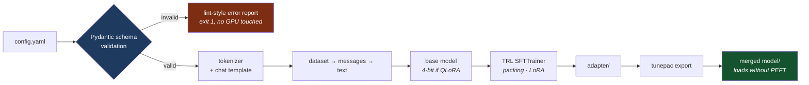
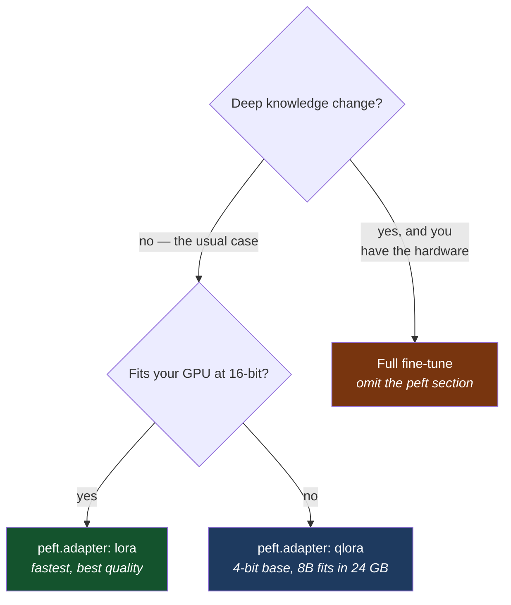

# Tunepac

[](https://github.com/700799/tunepac/actions/workflows/ci.yml)
[](https://www.python.org/)
[](https://github.com/700799/tunepac/blob/main/LICENSE)

**Teach an open-source AI model your company's job — by writing a short settings
file instead of writing training code.**

```bash
pip install "tunepac[train]"
tunepac train --config my_model.yaml
```

---

## Contents

**New here?** [What problem does this solve?](#for-the-non-engineer-what-problem-does-this-solve) ·
[What it does today](#what-it-does-today) · [Quick start](#quick-start)

**Using it:** [How it works](#how-it-works) ·
[Which adapter should I use?](#which-adapter-should-i-use) ·
[Installation](#installation) · [CLI reference](#cli-reference) ·
[Configuration reference](#configuration-reference) ·
[Dataset formats](#dataset-formats) · [Chat templates](#chat-templates) ·
[Recipes](#recipes) · [Troubleshooting](#errors-and-troubleshooting)

**Contributing:** [Architecture](#architecture) · [Development](#development) ·
[Roadmap](#roadmap) · [License](#license)

---

## For the non-engineer: what problem does this solve?

General-purpose AI models are generalists. They write decent email and know
nothing about *your* refund policy, *your* product catalog, or *your* house
style. **Fine-tuning** is the process of training a general model on your own
examples until it behaves the way you need.

The catch is that fine-tuning normally means an ML engineer hand-writing a
custom training program for every experiment. That is slow, hard to review, and
easy to get subtly wrong — and mistakes are expensive, because you often don't
discover them until hours of rented GPU time have already burned.

Tunepac replaces that program with a **recipe**: one readable text file that
says which model, which examples, and which settings. Hand it to Tunepac and it
runs the job.

| | Without Tunepac | With Tunepac |
|---|---|---|
| **What an experiment is** | A bespoke Python program | A ~30-line settings file |
| **Who can review it** | Only the engineer who wrote it | Anyone who can read a config |
| **Repeating last month's run** | Hope the script still exists | Re-run the same file |
| **Typo in a setting** | Discovered mid-run, or silently ignored | Rejected in under a second, before any GPU spend |
| **Hardware needed (8B model)** | Often a multi-GPU machine | One 24 GB gaming-class GPU |

**The cost angle.** Tunepac leans on a technique called QLoRA, which trains a
small "adapter" layer instead of rewriting the whole model. The practical effect
is that customizing an 8-billion-parameter model fits on a single high-end
consumer graphics card rather than a rented cluster — and the resulting adapter
is a file of tens of megabytes, not tens of gigabytes.

**The honest caveat.** This is young software (version 0.1), it is a tool for
technical teams, and it does not collect your data or supply the examples — you
still need a dataset and someone who understands what "good output" means for
your use case.

---

## What it does today

<picture>
  <source media="(prefers-color-scheme: dark)" srcset="https://raw.githubusercontent.com/700799/tunepac/main/docs/capability-radar-dark.svg">
  
</picture>

Same data, precisely — the low scores are the roadmap, not an oversight:

| Capability | Score | Where it stands |
|---|:---:|---|
| Config validation | 5/5 | Strict schema, unknown keys rejected, cross-field rules enforced before load |
| LoRA / QLoRA | 5/5 | Rank, alpha, dropout, target modules, NF4/FP4, double quantization |
| Dataset formats | 4/5 | alpaca · sharegpt · openai · completion. No multimodal, no streaming |
| Chat templates | 4/5 | chatml · llama3 · mistral · zephyr, or the tokenizer's own |
| Adapter export | 3/5 | Merge to a standalone model works. GGUF conversion not built |
| Multi-GPU | 3/5 | Runs under `accelerate launch`. No FSDP/DeepSpeed config passthrough |
| Preference tuning | 0/5 | No DPO/ORPO. SFT only |

---

## Quick start

**1. Install.** The base install is tiny and needs no GPU — it only validates
configs. Add `[train]` when you actually want to train:

```bash
pip install tunepac            # CLI + config validation, no CUDA, no torch
pip install "tunepac[train]"   # + torch, TRL, PEFT, Accelerate, bitsandbytes
```

**2. Write a config** — save as `my_model.yaml`:

```yaml
base_model:
  name: meta-llama/Meta-Llama-3-8B

dataset:
  path: yahma/alpaca-cleaned     # a Hub dataset, or your own .jsonl file
  format: alpaca
  chat_template: llama3

training:
  learning_rate: 2.0e-4
  epochs: 3
  batch_size: 2
  gradient_accumulation_steps: 8

peft:
  adapter: qlora                 # 4-bit base + trainable adapter
  r: 32

hardware:
  bf16: true
  gradient_checkpointing: true
```

**3. Check it before spending GPU time.** This runs in a second, on a laptop,
with no model download:

```console
$ tunepac validate --config my_model.yaml
Config OK — schema validation passed.
                   Tunepac run summary
┌───────────────────┬──────────────────────────────────────┐
│ Base model        │ meta-llama/Meta-Llama-3-8B           │
│ Dataset           │ yahma/alpaca-cleaned (alpaca)        │
│ Chat template     │ llama3                               │
│ Adapter           │ qlora (r=32, alpha=32)               │
│ Precision         │ bfloat16                             │
│ Batch             │ 2 x 8 accumulation = 16 effective    │
│ Sequence length   │ 2048                                 │
│ Output dir        │ outputs                              │
└───────────────────┴──────────────────────────────────────┘
```

**4. Train, then ship a standalone model:**

```bash
tunepac train  --config my_model.yaml   # writes an adapter
tunepac export --config my_model.yaml   # merges it into the base model
```

The merged model in `outputs/merged/` loads with a plain
`AutoModelForCausalLM.from_pretrained` — no Tunepac or PEFT needed at inference
time.

**Want to try it in 30 seconds instead?** `configs/test_smollm2.yaml` fine-tunes
a 135M-parameter model on five dummy rows and runs on a CPU:

```bash
python scripts/run_test.py
# PASS: LoRA adapter saved to output_test_adapter (34 KiB) in 6.8s
```

---

## How it works



The pipeline in words, for anywhere Mermaid doesn't render:

| Step | What happens | Fails fast if |
|---|---|---|
| 1. Validate | YAML → strict Pydantic schema | Unknown key, out-of-range value, contradictory settings |
| 2. Tokenizer | Load tokenizer, apply chat template | Template requested but the tokenizer has none |
| 3. Dataset | Records → role/content messages → rendered text | A record doesn't match the declared format |
| 4. Model | Load base model, 4-bit for QLoRA | Out of memory (reported with fixes to try) |
| 5. Train | TRL `SFTTrainer` with packing + LoRA | Out of memory |
| 6. Export | Merge adapter into base, save | No adapter found at the path |

**The design rule that matters:** every invariant is checked in step 1. The
trainer never re-checks what the schema guarantees, and nothing heavy is
imported until the config is known good — which is why `validate` runs on a
laptop with no CUDA.

### Which adapter should I use?



| Choice | Memory | Quality | When |
|---|---|---|---|
| `lora` | Moderate | Best of the three | The model already fits at 16-bit |
| `qlora` | Lowest | Very close to `lora` | The model doesn't fit — the common case for 7B+ on one GPU |
| *(omit `peft`)* | Highest | Highest ceiling | Deep behavior change, and you have the hardware |

**The economics in one line:** `validate` costs nothing and takes a second;
`train` costs GPU hours. Everything the schema can catch is caught in the first
one, which is the whole reason the validation is strict.

---

## Features

- **One YAML file per run.** Everything defining a fine-tune lives in one
  reviewable, diffable, version-controllable file.
- **Strict validation, early.** Every section rejects unknown keys, every field
  is typed and bounded, and cross-field rules (e.g. QLoRA requires half
  precision) are enforced in the schema. Errors read like a lint report, never a
  Python traceback.
- **LoRA and QLoRA out of the box.** Omit the `peft` section entirely for
  full-parameter fine-tuning.
- **Dataset flexibility.** Four record formats, Hub datasets or local
  `.jsonl`/`.json`/`.csv`/`.parquet`, automatic conversion to a common message
  form.
- **Token packing** via TRL, on by default, so short examples don't waste
  sequence budget.
- **Light by default.** The base install needs only `typer`, `pydantic`,
  `PyYAML` and `rich`. Heavy dependencies live behind `[train]` and are imported
  lazily.
- **Fail fast, fail helpfully.** Chat-template mismatches are caught before
  training; CUDA OOM is re-raised with ordered, concrete remedies.
- **Typed and tested.** `mypy --strict` clean, `py.typed` shipped, 87 tests
  including real end-to-end training runs.

---

## Installation

Requires Python 3.10+.

| Command | Gets you | Needs a GPU? |
|---|---|---|
| `pip install tunepac` | CLI, config validation, dataset checking | No |
| `pip install "tunepac[train]"` | Everything above + training and export | For real models, yes |
| `pip install "tunepac[dev]"` | Everything + pytest, ruff, mypy | No |

> **FlashAttention** (`hardware.flash_attention: true`) additionally requires
> the [`flash-attn`](https://github.com/Dao-AILab/flash-attention) package,
> which needs a CUDA toolchain to build. It is deliberately not in `[train]`.

> **TRL version.** `[train]` pins `trl<1.14`. TRL 1.14 introduced a Triton
> kernel in the SFT loss path with no CPU fallback, which breaks CPU training
> entirely. The pin will be lifted when upstream restores a non-Triton path.

---

## CLI reference

All commands take `--config` / `-c <path>`.

| Command | Status | Purpose |
|---|---|---|
| `tunepac train` | working | Run the fine-tuning job described by the config |
| `tunepac validate` | working | Validate the config; optionally sample local datasets |
| `tunepac export` | working | Merge a trained adapter into its base model |

### `tunepac train --config <file>`

Prints the run summary, then loads tokenizer, dataset and model and hands off to
TRL's `SFTTrainer`. Exit codes: `0` success · `1` config/dataset/template error,
OOM, or missing training extras.

### `tunepac validate --config <file> [--check-dataset | --no-check-dataset]`

Validates against the schema and prints the run summary. With `--check-dataset`
(the default) local dataset files are opened and their first records checked
against the declared `format` — using only the standard library, so it works on
a base install. Hub dataset ids are noted and deferred to training time.

Exit codes: `0` valid · `1` schema or dataset problems, each listed.

### `tunepac export --config <file> [--adapter DIR] [--output DIR]`

Merges a trained LoRA/QLoRA adapter into its base model, writing a standalone
model directory. `--adapter` defaults to `training.output_dir`; `--output`
defaults to `<adapter>/merged`. The tokenizer saved with the adapter is carried
over, so an overridden chat template survives the merge.

**QLoRA note:** even when the config says `adapter: qlora`, the base model is
loaded *unquantized* for the merge — merging LoRA weights into 4-bit NF4 weights
loses precision, so the merge happens in the config's compute dtype.

Exit codes: `0` merged · `1` no `peft` section, missing/invalid adapter, or
missing training extras. GGUF conversion is not implemented; see
[Roadmap](#roadmap).

### Global flags

`tunepac --version` prints the installed version.

---

## Configuration reference

A config is a YAML mapping of up to five sections. **`base_model` and `dataset`
are required**; `training` and `hardware` have defaults; `peft` is optional
(omit it for full fine-tuning). Unknown keys anywhere are errors. Source of
truth: [`tunepac/config/schema.py`](https://github.com/700799/tunepac/blob/main/tunepac/config/schema.py).

### `base_model`

| Field | Type | Default | Notes |
|---|---|---|---|
| `name` | str | *required* | Hub id (`meta-llama/Meta-Llama-3-8B`) or local path |
| `revision` | str \| null | `null` | Git revision (branch, tag, commit) of the Hub repo |
| `tokenizer_name` | str \| null | `null` | Load a different tokenizer than the model's own |
| `trust_remote_code` | bool | `false` | Allow executing custom modeling code from the Hub repo |

### `dataset`

| Field | Type | Default | Notes |
|---|---|---|---|
| `path` | str | *required* | Hub dataset id, or local `.jsonl`/`.json`/`.csv`/`.parquet` |
| `format` | enum | `alpaca` | `alpaca` · `sharegpt` · `openai` · `completion` |
| `chat_template` | enum \| null | `tokenizer_default` | `tokenizer_default` · `chatml` · `llama3` · `mistral` · `zephyr` · `null` |
| `split` | str | `train` | Split to train on (Hub datasets) |
| `text_field` | str | `text` | Column holding raw text; **only** for `format: completion` |
| `validation_split` | float \| null | `null` | Fraction held out for eval; `0 < x < 0.5` |
| `max_samples` | int \| null | `null` | Cap on records — handy for smoke tests; `≥ 1` |
| `shuffle` | bool | `true` | Shuffle (seeded by `training.seed`) before training |

Rules: `format: completion` requires `chat_template: null`; the conversational
formats require a non-null `chat_template`.

### `training`

| Field | Type | Default | Notes |
|---|---|---|---|
| `output_dir` | path | `./outputs` | Checkpoints, logs, final adapter/model |
| `learning_rate` | float | `2e-4` | `0 < x ≤ 1` |
| `epochs` | float | `1.0` | Ignored when `max_steps` is set |
| `max_steps` | int \| null | `null` | Hard cap on optimizer steps; overrides `epochs` |
| `batch_size` | int | `1` | Micro batch size **per device** |
| `gradient_accumulation_steps` | int | `1` | Effective batch = `batch_size × this`, per device |
| `warmup_steps` | int | `0` | Mutually exclusive with `warmup_ratio` |
| `warmup_ratio` | float | `0.0` | Warmup as a fraction of total steps; `0 ≤ x ≤ 1` |
| `lr_scheduler` | enum | `cosine` | `linear` · `cosine` · `cosine_with_restarts` · `constant` · `constant_with_warmup` |
| `optimizer` | enum | `adamw_torch` | `adamw_torch` · `adamw_torch_fused` · `adamw_8bit` · `paged_adamw_8bit` · `paged_adamw_32bit` |
| `weight_decay` | float | `0.0` | `≥ 0` |
| `max_grad_norm` | float | `1.0` | Gradient clipping; `> 0` |
| `max_seq_length` | int | `2048` | Tokens per sequence after packing/truncation; `≥ 8` |
| `packing` | bool | `true` | Pack multiple short examples per window |
| `logging_steps` | int | `10` | |
| `save_steps` | int | `500` | |
| `eval_steps` | int \| null | `null` | Requires `dataset.validation_split` |
| `save_total_limit` | int \| null | `3` | Older checkpoints beyond this are deleted |
| `seed` | int | `42` | Seeds shuffling, splitting, and the trainer |
| `resume_from_checkpoint` | path \| null | `null` | Checkpoint directory to resume from |
| `report_to` | enum | `none` | `wandb` · `tensorboard` · `none` |

> **`warmup_ratio` note.** transformers 5 removed ratio-based warmup from
> `TrainingArguments`, so Tunepac converts the ratio to a step count itself from
> the estimated total updates. With `packing` on, the estimate errs slightly
> long — acceptable for a warmup heuristic.

### `peft`

Omit this whole section for full-parameter fine-tuning.

| Field | Type | Default | Notes |
|---|---|---|---|
| `adapter` | enum | *required* | `lora` (full-precision base) or `qlora` (4-bit base) |
| `r` | int | `16` | LoRA rank; `1–1024` |
| `lora_alpha` | int | `32` | Scaling numerator |
| `lora_dropout` | float | `0.05` | `0 ≤ x < 1` |
| `target_modules` | list[str] \| `"all-linear"` | `all-linear` | Modules to wrap, or auto-detect linear layers |
| `bias` | enum | `none` | `none` · `all` · `lora_only` |
| `use_rslora` | bool | `false` | Rank-stabilized scaling (`alpha / √r`) |
| `quantization` | mapping \| null | auto | 4-bit details; **only valid with `qlora`** |

`quantization` sub-fields: `bnb_4bit_quant_type` (`nf4` or `fp4`, default `nf4`)
and `bnb_4bit_use_double_quant` (default `true`).

### `hardware`

| Field | Type | Default | Notes |
|---|---|---|---|
| `bf16` | bool | `true` | bfloat16 (Ampere or newer) |
| `fp16` | bool | `false` | float16 (older GPUs). Mutually exclusive with `bf16` |
| `flash_attention` | bool | `false` | FlashAttention-2; needs the `flash-attn` package |
| `gradient_checkpointing` | bool | `true` | Recompute activations backward to save memory |
| `tf32` | bool | `true` | TF32 matmuls on Ampere+ (no effect elsewhere) |

With both `bf16` and `fp16` false, training runs in float32.

### Cross-section rules

Enforced at validation time, before anything loads:

| Rule | Why |
|---|---|
| `bf16` and `fp16` cannot both be true | They are different compute dtypes |
| `warmup_steps` and `warmup_ratio` cannot both be set | Ambiguous intent |
| `eval_steps` requires `dataset.validation_split` | Nothing to evaluate against |
| `qlora` requires `bf16` or `fp16` | 4-bit needs a half-precision compute dtype |
| `quantization` only with `qlora` | Meaningless for an unquantized base |
| `format: completion` ⇔ `chat_template: null` | Raw text has no turns to render |

---

## Dataset formats

Conversational formats are normalized to OpenAI-style `[{role, content}]`, then
rendered through the chat template. `completion` data is used as-is.

| Format | Shape | Required keys |
|---|---|---|
| `alpaca` | `{"instruction": …, "input": …, "output": …}` | `instruction`, `output` |
| `sharegpt` | `{"conversations": [{"from": …, "value": …}]}` | `conversations` |
| `openai` | `{"messages": [{"role": …, "content": …}]}` | `messages` |
| `completion` | `{"text": "raw text"}` | the `text_field` column |

```json
{"instruction": "Translate to German.", "input": "Good morning!", "output": "Guten Morgen!"}
{"conversations": [{"from": "human", "value": "Hi!"}, {"from": "gpt", "value": "Hello!"}]}
{"messages": [{"role": "user", "content": "Hi!"}, {"role": "assistant", "content": "Hello!"}]}
```

For `alpaca`, a non-empty `input` is appended to the instruction (blank line
between) to form the user turn. ShareGPT speakers map `system→system`,
`human`/`user→user`, `gpt`/`assistant→assistant`; unknown speakers are an error.

A `path` ending in `.jsonl`/`.json`/`.csv`/`.parquet` is a local file (`.json`
must be a list of records); anything else is a Hub dataset id.

---

## Chat templates

| Value | Effect |
|---|---|
| `tokenizer_default` | Keep whatever template the tokenizer ships. Fails fast if it has none |
| `chatml` / `llama3` / `mistral` / `zephyr` | Overwrite with a known Jinja template, making rendered text deterministic across base models |

Match the template to the model family when fine-tuning an instruct model, or
choose deliberately when teaching a base model a chat format from scratch.

---

## Recipes

### QLoRA on Llama-3-8B, single 24 GB GPU

[`example_config.yaml`](https://github.com/700799/tunepac/blob/main/example_config.yaml) in full: NF4 double-quantized
4-bit base, LoRA r=32 on all attention and MLP projections, paged 8-bit AdamW,
packing at 4096 tokens, bf16, FlashAttention-2, gradient checkpointing.

### CPU smoke test, under 30 seconds

[`configs/test_smollm2.yaml`](https://github.com/700799/tunepac/blob/main/configs/test_smollm2.yaml) — SmolLM2-135M with
LoRA r=8 on five dummy rows in float32. `python scripts/run_test.py` writes the
data, trains, and verifies the adapter.

### Full fine-tune

Delete the `peft` section. Expect an order of magnitude more memory. (`export`
correctly refuses these — there is no adapter to merge.)

### Multi-GPU

```bash
accelerate config          # once, to describe your machine
accelerate launch -m tunepac.cli train --config my_model.yaml
```

`batch_size` and `effective_batch_size` are **per device** — multiply by world
size for the global batch.

---

## Errors and troubleshooting

### Config errors read like a lint report

```console
$ tunepac validate --config bad.yaml
Invalid configuration (3 error(s)):
  training.learning_rate: Input should be less than or equal to 1
  peft.lora_droput: Extra inputs are not permitted
  hardware: Value error, hardware.bf16 and hardware.fp16 are mutually exclusive
```

Every problem is listed with its `section.field` path; exit code 1. You never
get a Python traceback for a bad config. Field-level errors are reported first;
cross-field rules run once the fields themselves parse.

### Out of memory

Caught and re-raised with ordered suggestions, cheapest first:

```text
Ran out of GPU memory during training.
Suggestions:
  - Lower training.batch_size (raise gradient_accumulation_steps to keep the effective size)
  - Enable hardware.gradient_checkpointing
  - Reduce training.max_seq_length
  - Switch peft.adapter to 'qlora' to load the base model in 4-bit
  - Use a paged optimizer (training.optimizer: paged_adamw_8bit)
```

### Other common cases

| Symptom | Cause | Fix |
|---|---|---|
| `ships no chat template` | `tokenizer_default` on a base model without one | Set an explicit template |
| `Training dependencies are not installed` | Base install | `pip install "tunepac[train]"` |
| `record 3: alpaca record is missing keys ['output']` | Dataset doesn't match `format` | Fix the record or the format |
| `Adapter directory not found` | `export` before `train`, or wrong `--adapter` | Point at the training output |
| `does not look like a PEFT adapter` | Directory has no `adapter_config.json` | Use a directory `tunepac train` produced |

---

## Architecture

```
tunepac/
├── tunepac/
│   ├── cli.py                  # Typer entry point: train / validate / export
│   ├── config/
│   │   ├── schema.py           # Pydantic v2 schema — the contract
│   │   └── loader.py           # YAML → TunepacConfig, lint-style errors
│   ├── data/
│   │   ├── formatting.py       # format registry, record → messages, cheap checks
│   │   └── chat_templates.py   # named Jinja chat templates
│   ├── training/trainer.py     # validated config → TRL SFTTrainer (lazy imports)
│   ├── export/merge.py         # adapter → standalone merged model
│   ├── utils/errors.py         # TunepacError hierarchy
│   └── py.typed                # PEP 561
├── configs/test_smollm2.yaml   # CPU smoke-test recipe
├── scripts/run_test.py         # end-to-end smoke test
├── docs/                       # README assets
├── tests/                      # unit + integration suites
└── example_config.yaml         # Llama-3-8B QLoRA recipe
```

Three principles:

1. **The schema is the contract.** All invariants live in `schema.py`. The
   trainer maps an already-valid config onto library objects and never
   re-validates. Runtime checks are reserved for what only a live tokenizer,
   dataset, or GPU can reveal.
2. **Heavy imports are lazy.** `torch`/`trl`/`peft` are imported inside
   functions, keeping the CLI usable without them. Commands that need them
   check up front and print an install hint.
3. **Deliberate errors are typed.** Everything raised on purpose derives from
   `TunepacError`, so the CLI catches one type and exits cleanly — while genuine
   bugs still produce a traceback.

---

## Development

```bash
pip install -e ".[dev]"
pytest            # unit tests; integration tests skip without the [train] extra
ruff check .      # lint
mypy              # strict type-checking
```

| Tier | Needs `[train]`? | Covers |
|---|---|---|
| Unit | No | Schema invariants, YAML loading/errors, format conversion, chat-template rendering, CLI behavior |
| Integration | Yes | Builds a ~100k-parameter Llama checkpoint and BPE tokenizer at test time (no network) and drives the real `run_training` and `merge_adapter` end to end |

The merge test asserts that a LoRA-targeted weight changed while an untargeted
one did not — so a merge that silently copied the base would fail.

CI runs ruff + strict mypy, the unit suite with coverage on Python 3.10/3.11/3.12,
and the integration suite on CPU-only torch.

Contributions welcome — keep `pytest`, `ruff check .` and `mypy` green, add
tests for behavior changes, and treat schema changes as API changes.

---

## Roadmap

| Item | Status |
|---|---|
| GGUF conversion for llama.cpp runtimes | Needs llama.cpp's converter, not a pip dependency |
| Preference tuning (DPO / ORPO) | Not started |
| FSDP / DeepSpeed passthrough in `hardware` | Not started |
| Richer W&B run configuration | Not started |

---

## License

[MIT](https://github.com/700799/tunepac/blob/main/LICENSE)
